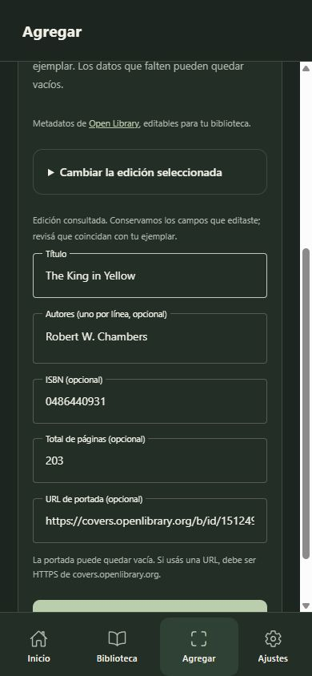
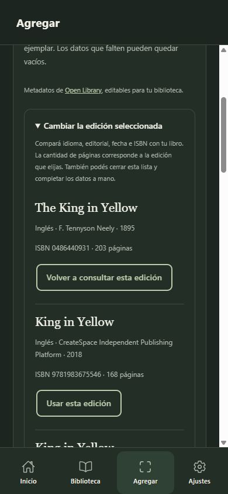
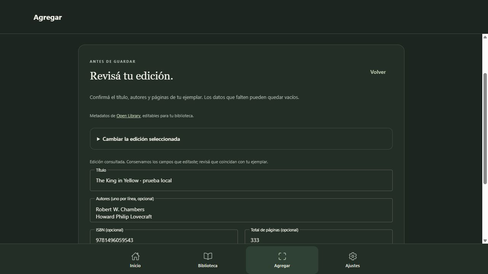

# Corrección de ediciones y campos vacíos en Open Library

15 de noviembre de 2026, America/Buenos_Aires. Cliente **0.4.2**. Corrección posterior al PR 4, exclusivamente local y sin comandos Git. No se agregaron otros proveedores, etiquetas ni géneros.

## Diagnóstico confirmado

La búsqueda por título devolvía obras con `idEdicionExterna`, ISBN y páginas nulos de forma deliberada. Revisar un resultado copiaba esos metadatos sin consultar ninguna edición. La consulta por ISBN sí extraía `number_of_pages` y resolvía referencias de autores. Además, el formulario reiniciaba todos sus controles cuando recibía nuevos datos: conservar la marca dirty no protegía sus valores.

La edición pública [OL49631747M](https://openlibrary.org/books/OL49631747M.json) contiene `number_of_pages: 308`, referencia al autor OL162057A y obra OL8127201W, pero no informa ISBN. El autor devuelve Robert W. Chambers. Esto exige poder elegir una edición por identificador de Open Library, además del recorrido por ISBN. No sería correcto asignar sus 308 páginas a todas las ediciones de la obra.

## Implementación

- Se conserva una sola llamada liviana por búsqueda inicial y se usa el orden de relevancia de Open Library.
- Revisar una obra solicita sus ediciones de diez en diez, mostrando idioma, editorial, fecha, ISBN y páginas de cada registro. El listado no consulta autores por cada fila.
- Usar una edición consulta su registro completo y reutiliza la resolución de autores y alternativa de obra. Una edición sin ISBN también puede elegirse. Si el resultado ya viene de ISBN con edición identificada, no se descarga el listado de ediciones.
- Ante detalles parciales se conservan datos ya obtenidos de esa misma edición y, cuando corresponde, autores de su obra conocida. No se copian páginas de otra edición ni de una obra. Los reintentos mantienen el candidato solicitado original, sin combinar el identificador nuevo con los datos de la selección anterior.
- El formulario actualiza por control: conserva cualquier campo editado, incluso vaciado manualmente. Los valores automáticos sí se actualizan al elegir otra edición. Durante la consulta se puede escribir; Guardar espera la respuesta.
- Las solicitudes reemplazadas y las de una vista que se abandona se cancelan. Los fallos conservan el formulario y permiten reintentar o completar a mano. Se mantienen caché, intervalo entre llamadas y presupuesto global del proveedor.

Contrato ampliado con `GET /catalogo/obras/{id}/ediciones` y `GET /catalogo/ediciones/{id}`. Los identificadores tienen validación de tipo y longitud; el detalle verifica que el identificador recibido corresponda al solicitado. Los nuevos campos descriptivos del listado no se agregan al modelo persistente. No hay migración ni actualización automática de libros guardados. La app sigue sin cuenta ni contraseña.

## Verificación automatizada

- Backend, `mvnw.cmd verify`: **62 pruebas**, cero fallos, errores u omisiones; JAR ejecutable y contrato OpenAPI validados.
- Cliente: lint aprobado, **80 pruebas Angular**, 12 archivos y ningún fallo; build de producción aprobado.
- Scripts Android: **4 pruebas** aprobadas.
- `android:build`: **BUILD SUCCESSFUL**, APK debug **0.4.2**, con la configuración local de API solo en debug.

Casos nuevos: 308 páginas y Robert W. Chambers sin ISBN; caché de edición; listado paginado sin llamadas de autores por fila; rechazo de otra edición y referencias inválidas; campos manuales conservados frente a respuesta tardía; vacíos deliberados; páginas automáticas actualizadas al cambiar edición; cancelación de resultados obsoletos; error y reintento; recuperación parcial de la misma edición; reintento de otra edición sin arrastrar páginas anteriores. Se mantiene el resto de las pruebas de libros, avances, idempotencia y acceso local.

## Recorrido con API y navegador reales

Se reinició únicamente el servidor temporal en memoria de las pruebas del PR 4. No se modificó una base persistente del usuario. La nueva instancia usa H2 en memoria y Open Library real.

1. `GET /api/v1/catalogo/ediciones/OL49631747M` devolvió título The king in yellow, Robert W. Chambers, **308 páginas**, ISBN nulo y el identificador exacto solicitado.
2. El listado de OL8127201W devolvió **479 ediciones**, diez en la primera página. Se comprobó la segunda página desde la interfaz.
3. Buscar The king in yellow mostró primero la obra de Robert W. Chambers; revisar abrió el selector de ediciones.
4. Se eligió una edición de **203 páginas**, y luego otra de **168**: las páginas automáticas cambiaron y se conservó un título escrito a mano.
5. Se escribió manualmente **333** como total de prueba y se eligió una edición que informaba **270**: se conservaron las 333 deliberadas. Se guardó y el detalle mostró la edición seleccionada, sus autores, el título manual y página 0 de 333. Es un dato sintético para probar la protección, no la paginación atribuida por el proveedor.
6. Se volvió a abrir un formulario nuevo y se verificó completado automático de título, autor, ISBN y 203 páginas en la primera edición. Se inspeccionaron móvil **390 × 844** y escritorio **1280 px**, restableciendo el viewport al terminar.

Las capturas de 203 páginas corresponden a una edición distinta de OL49631747M. Precisamente no se sustituyen sus páginas por las 308 del ejemplo original.

## Límites

Si Open Library realmente omite un dato o no permite completar una consulta dentro del presupuesto, el campo puede seguir vacío y editable; no se inventa información ni se consulta otro proveedor. La edición concreta sigue requiriendo revisión humana. Los libros guardados no se reescriben al consultar catálogo.

El teléfono no estaba conectado al preparar esta actualización: el APK 0.4.2 se compiló, pero no se instaló ni se declara una nueva prueba física. El escáner nativo conserva la integración del PR 4. El backend temporal actualizado queda disponible en 127.0.0.1:8080 para continuar la prueba; sus datos son descartables y en memoria. La vista web temporal se detiene al cerrar la verificación.
