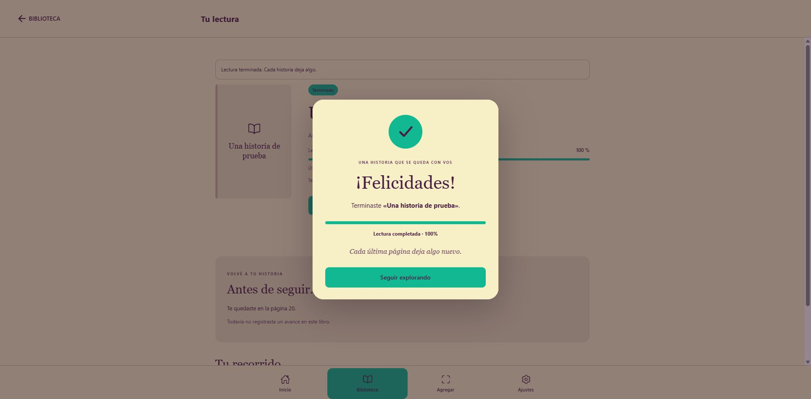

# Correcciones 0.5.1: progreso, felicitación, colores e icono

15 de noviembre de 2026. Cambios pedidos por la autora después del PR 5. Trabajo local, sin comandos Git y sin cambios de código, datos o despliegue en Azure.

## Comportamiento final

- Un libro con estado TERMINADO muestra barra y porcentaje al 100%, tanto en tarjetas como en detalle, incluyendo datos consultados desde copia local. Aplica también si no hay total de páginas.
- El cliente conserva la última página registrada del servidor y la muestra con esa etiqueta. Reabrir la lectura recupera el porcentaje calculado por página; sin total, vuelve a mostrar posición sin porcentaje. El contrato y las reglas del backend no se modifican.
- Marcar terminado pide confirmación cuando corresponde y, solo después de confirmar la escritura, muestra «¡Felicidades! Terminaste “título”» con el fondo atenuado. El botón, el fondo y Atrás permiten cerrar el modal.
- Guardar un avance que termina la lectura también puede presentar la felicitación. El evento conserva el estado previo a la petición y se emite tras cerrar el modal de avance, evitando perder el aviso si el detalle se refresca antes y evitando superponer ambos modales.
- Cancelar o recibir un error no cambia el libro ni muestra felicitación. Abrir un libro ya terminado no vuelve a celebrar automáticamente.

## Paleta

Fondos y superficies claras **#F7EFC6**, títulos/texto/iconos y navegación **#4B1D45**, botones/progreso/etiquetas y elementos destacados **#12B892**. Se conserva el selector sistema/claro/oscuro con una adaptación ciruela para oscuro.

Los botones sólidos tienen texto ciruela sobre turquesa; los botones de texto/contorno y etiquetas de campos usan ciruela o crema según el tema. Contrastes calculados: ciruela/crema 11,61:1, ciruela/turquesa 5,32:1 y texto secundario/crema 6,64:1. Estos cálculos no sustituyen una auditoría completa de accesibilidad.

## Icono de instalación

El archivo encontrado en la carpeta indicada es **`icon/iconooooooo.png`**, con más letras “o” que el nombre aproximado del pedido. Se usa ese archivo original, sin edición de píxeles. Su copia está en `frontend/nativo/android/res/drawable-nodpi/nivi_icono.png`; el icono adaptativo normal/redondo y el splash lo referencian. El PNG no se coloca dentro de las pantallas: la marca interna conserva su SVG con la paleta actualizada.

La inspección del APK verificó que `res/drawable-nodpi-v4/nivi_icono.png` coincide **byte por byte** con el archivo de la carpeta raíz. Android aplica su máscara de launcher al icono adaptativo. La apariencia física del launcher/splash se debe comprobar al instalar en el teléfono.

## Validación ejecutada

| Comprobación | Resultado |
| --- | --- |
| ESLint | Aprobado, cero advertencias |
| Angular/Vitest | **111 pruebas**, 15 archivos, todas aprobadas |
| Scripts Android | **4 pruebas** aprobadas, incluida regeneración idempotente y conservación del PNG |
| Build web producción | Aprobado, aproximadamente 585,5 kB iniciales sin comprimir |
| Android debug | **BUILD SUCCESSFUL**, versión 0.5.1, versionCode 501 |
| Contenido del APK | PNG original exacto, recursos propios y configuración HTTPS de Azure comprobados |

Las siete pruebas nuevas cubren finalización con/sin total, reapertura, respuesta confirmada, cancelación/error y conservación del estado anterior cuando el detalle se refresca antes del cierre del modal de avance. No se repitieron pruebas del backend porque no hubo cambios allí; la verificación de 64 pruebas pertenece al PR 5 anterior.

## Recorrido visual observado

En Chrome se sirvió el build local con una API de prueba en memoria en 127.0.0.1:8101, sin conexión a Azure. Se usó exclusivamente el libro ficticio «Una historia de prueba», página 20 de 120.

Se eligió claro, se marcó terminado y se confirmó la acción. La vista pasó de 16,6% a 100%, conservando página 20, y presentó el modal. Se cerró con el botón y se reabrió la lectura: volvió a 16,6%. No se crearon ni modificaron libros reales ni se escribió en Azure. El servidor aislado de prueba se detuvo al terminar.

## APK local y límites

Salida actual: `frontend/android/app/build/outputs/apk/debug/app-debug.apk`.

- Versión: **0.5.1**, debug, **37 122 191 bytes**.
- SHA-256: `f152b932d461622a1ca68c9162e2e1e9ae2c55b6549a901e46d2077611aa9605`.
- API configurada: HTTPS del backend de Azure, prefijo `/api/v1`, sin credenciales.

No se publicó ni se instaló este APK en el teléfono en esta etapa. Launcher/splash, modo avión y regresión física de cámara/Atrás conservan su aceptación pendiente. La captura del modal es una prueba visual real del frontend con datos simulados locales, no una escritura de prueba en Azure ni una captura de Android.

## Instalación posterior en teléfono

15/11/2026: a pedido de la autora, se instaló el APK 0.5.1 por USB en el Samsung SM-A546E mediante `adb install -r`. Resultado: Success. Se comprobó en el paquete instalado `versionName=0.5.1` y `versionCode=501`. No se desinstaló la app ni se borraron sus datos. Esta verificación confirma instalación, no aceptación física de icono/splash, cámara, modo avión o finalización.

## Versión posterior

El APK del directorio de salida fue reemplazado por 0.5.2, que corrige Atrás desde Inicio y se instaló en el mismo Samsung. [Evidencia de retorno Android](RETORNO_ANDROID_052.md). Tamaño y hash de este documento corresponden exclusivamente a la versión histórica 0.5.1.
