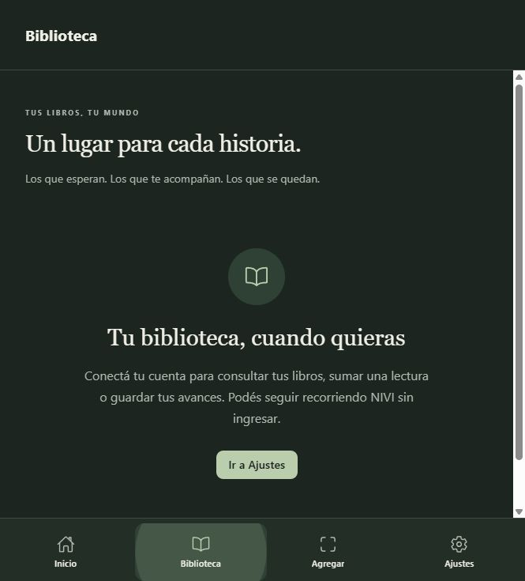

# PR 3 — Catálogo, biblioteca y seguimiento de lectura

Validación local del 14 de noviembre de 2026, America/Buenos_Aires. Cliente 0.3.0. Proyecto nuevo; no se ejecutaron comandos Git, ni se crearon commits, ramas o PR remotos. Backend y contrato permanecen como en PR 1.

## Alcance implementado

Catálogo por título/autor e ISBN, confirmación editable y alta manual. Biblioteca con búsqueda, filtro de estado y páginas de doce libros. Detalle con edición, eliminación confirmada e historial de diez registros. Modal de avance con página y nota, corrección confirmada, estados y reapertura. Inicio con conteos, hasta tres lecturas activas y enlaces para continuar. «Antes de seguir…» usa la última nota, fecha y posición reales; sin nota o total se informa su ausencia.

Las cuatro pestañas siguen públicas. Los datos del servidor requieren conectar la cuenta desde Ajustes. Se mantienen errores por campo, carga, vacío, reintento y portadas alternativas. No hay cámara ni copia offline en esta etapa.

## Verificación automatizada

Desde la raíz:

```powershell
npm --prefix frontend run lint
npm --prefix frontend test -- --watch=false
npm --prefix frontend run test:scripts
npm --prefix frontend run build
```

- Lint: cero advertencias y errores.
- Angular/Vitest: **60 pruebas aprobadas, 12 archivos**, ninguna fallida.
- Scripts Android: **3 pruebas aprobadas**, ninguna fallida.
- Build de producción aprobado dentro de los presupuestos. Carga inicial aproximada: **590 kB** sin comprimir; funcionalidades diferidas.

Casos cubiertos: sesión e interceptor, configuración, catálogo vacío/incompleto y errores 404/503/504, ISBN, posiciones negativas/decimales/excedidas, avances sin total, cuerpo/UUID de reintento, bloqueo de doble envío, conflicto con borrador conservado, cancelación de corrección, limpieza de pendientes, finalización del refresher en éxito/error/cancelación, respuestas obsoletas, 404 sin datos antiguos, actualización al entrar, nota real como texto plano y porcentaje que no redondea prematuramente a 100. La eliminación se prueba cancelada y confirmada con versión vigente, limpiando libro, notas y operación pendiente. El cierre comprueba cancelación y borrado del token antes del reinicio.

No se repitieron las 51 pruebas del backend porque no cambió; sus resultados y alcance están en [PR1.md](PR1.md). Las pruebas automatizadas del catálogo no necesitan Internet.

## Recorrido con servidor real

Se usó el JAR Java 21 del PR 1 con H2 en memoria, cuenta y notas sintéticas, y el servidor Angular en localhost:8100. No se usó una biblioteca personal. Las escrituras se verificaron mediante la interfaz y consultas a la API propia; se generaron datos auxiliares por HTTP para paginación y concurrencia. Ambos servidores temporales se detuvieron al terminar; la base de prueba en memoria se descartó.

1. Inicio público, conexión opcional en Ajustes y resumen vacío real. Alta manual de «El viaje de las palabras» sin ISBN ni portada, con 120 páginas.
2. Iniciar lectura; rechazar página 121; guardar página 35 y nota. Inicio y detalle muestran el avance confirmado. Corregir a 30 con confirmación y conservar ambos registros; pausar y retomar.
3. Rechazar un total de 29 inferior a la posición, conservando el formulario. Quitar el total y mostrar solo la página, sin porcentaje.
4. Modificar el libro desde otra petición mientras el modal conserva un borrador de página 45: 409 real, recuperación de versión y nota conservada. Revisión y nuevo envío deliberado exitoso.
5. Consultar **9780140328721** contra Open Library en vivo: «Fantastic Mr. Fox», Roald Dahl, 96 páginas y portada. Confirmar y guardar esa edición. Registrar 24/96, mostrar 25 % y la última nota; llegar a 96 finaliza y recibe fecha del servidor. Reabrir conserva 96 y elimina la fecha de finalización.
6. Buscar «Roald Dahl» contra Open Library: el primer intento respondió timeout 504; «Volver a intentar» recuperó resultados reales. Seleccionar «The Mildenhall treasure» muestra la advertencia de obra sin edición y deja ISBN/páginas vacíos. No se guardó ese candidato.
7. Quince libros permiten recorrer Biblioteca en páginas de doce y tres; más de diez avances permiten comprobar la segunda página del historial. Búsqueda por autor y filtro de estado muestran coincidencias y ausencia de coincidencias correctamente.
8. Gesto real de `ion-refresher`: Biblioteca filtrada por terminados mostraba un libro; otra petición lo reabrió. El gesto actualizó el resultado a cero sin recargar toda la app. La finalización ante errores se cubre automáticamente.
9. Abrir el diálogo de eliminación y cancelarlo conserva el libro y su historial. No se ejecutó una eliminación irreversible desde el navegador; la ejecución está cubierta por la prueba simulada del cliente y las pruebas previas de servidor.
10. Visitar un detalle con nota, cambiar a Ajustes y cerrar sesión: vuelve a Inicio, desaparece la nota del documento completo y no quedan componentes de detalle conservados. Pulsar Biblioteca abre su estado público desconectado, sin redirigir a login. Se comprobó también el aviso de la ruta de vencimiento; el temporizador y la limpieza se verifican en las pruebas de sesión.

La revisión incluyó móvil de 390 × 844 y las vistas de mayor ancho. Se conservaron las cuatro pestañas, los formularios y el modal Ionic; no se certifica aún la navegación nativa ni el botón Atrás de Android.

## Capturas

Datos de prueba, sin tokens ni notas personales reales. Las capturas del detalle y del modal corresponden al estado intermedio de 24/96, antes de finalizar/reabrir la lectura.




## Límites y siguiente etapa

Los identificadores y cuerpos de escrituras inciertas se conservan **solo durante la sesión en memoria**. Recargar completamente o cerrar sesión elimina esos pendientes; si se perdió una respuesta, consultar Biblioteca/historial antes de iniciar otra operación. No se persiste una cola de notas ni se permite escribir sin conexión.

Open Library puede estar incompleto o no disponible; siempre existe alta manual. La validación en vivo prueba los casos descritos, no la disponibilidad futura del proveedor. No hay ejecución de CI remota, APK compilado ni pruebas de cámara. PR 4 continúa con escáner, preparación Android actualizada y comprobación con libro físico, incluyendo el reinicio de navegación al salir. PR 5 queda para copia de consulta, apariencia y entrega.
