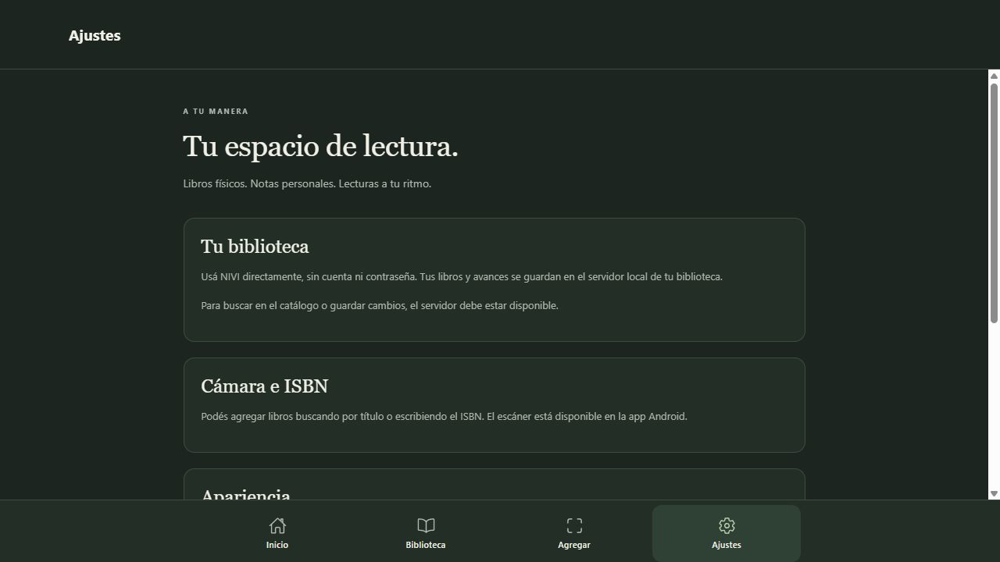
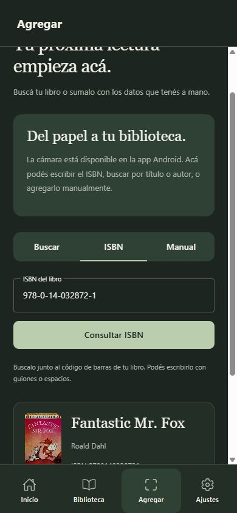
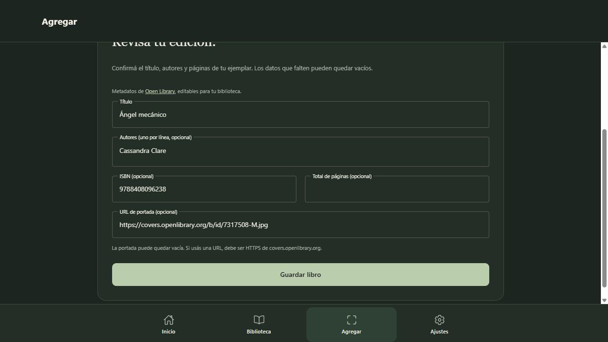

# PR 4 — Escáner ISBN y Android

15 de noviembre de 2026, America/Buenos_Aires. Trabajo local, sin comandos Git ni publicación. Cliente final **0.4.1**, instalado en Samsung **SM-A546E / Android 16**.

## Resultado y corrección de alcance

Se integra cámara Android detrás de `EscanerIsbn`, con lectura EAN-13, prefijo 978/979 y checksum. Solo tocar Escanear importa el plugin y abre su pantalla de permiso/cámara. Usa ZXing, cámara trasera y orientación adaptable; los resultados se consultan en el backend y requieren confirmación antes de guardar. Navegador mantiene ISBN escrito, título/autor y alta manual.

La primera iteración 0.4.0 conservaba acceso opcional del PR 3. El usuario aclaró que quería quitar la cuenta por completo. La 0.4.1 retira formulario, guardas, interceptor y token; Biblioteca, catálogo, detalle y cámara funcionan directamente. Ajustes ya no ofrece conectar cuenta y `/acceso` redirige a Inicio. El backend incorpora perfil `local` predeterminado sin credenciales, exclusivo de 127.0.0.1, y conserva el perfil técnico `seguro` como alternativa. [Decisión vigente](../decisiones/inicio-sin-login.md).

Este cambio de backend en PR 4 queda declarado: además del modo local, se corrige la recuperación de autor cuando la edición solo enlaza una obra. No se cambian reglas de lectura, transacciones, esquema persistente ni DTO de libros.

## Versiones y reproducción

- Barcode Scanner **3.1.2**, compatible con Capacitor 8; App **8.0.1** para Atrás de Ionic.
- JDK **21.0.11**, minSdk **26**, compileSdk/targetSdk **36**.
- Android Gradle Plugin **8.13.0**, Gradle Wrapper **8.14.3**, Kotlin **2.2.20** del plugin.
- Fuente nativa `frontend/nativo/android/AndroidManifest.xml`: CAMERA/INTERNET, cámara opcional, sin permisos al arrancar.
- `android:preparar` genera/sincroniza Android y aplica scripts propios para SDK, versión y debug. Repetirlo no duplica parches.
- `android:build` compila mediante el Wrapper; `versionCode=401`, `versionName=0.4.1` comprobados en el teléfono.

Se instaló mediante `adb install -r` y se conectó la API de PC por `adb reverse tcp:8080 tcp:8080`. La URL HTTP solo está en debug, limitada a 127.0.0.1. El backend temporal usa H2 en memoria; no se expuso en LAN ni se usó una base personal. El funcionamiento habitual usa H2 persistente según la guía.

Se repitió `npm ci` y `android:build` sobre una copia independiente de fuentes 0.4.1, sin `android/`, `www/` ni `node_modules/`. Se generó una plataforma nueva y Gradle terminó **BUILD SUCCESSFUL**, con **156 tareas ejecutadas**. La prueba usó HTTPS de ejemplo sin consultar esa API y reutilizó solamente las cachés normales de npm/Gradle del equipo. La carpeta de trabajo del usuario se conservó.

Salida local: `frontend/android/app/build/outputs/apk/debug/app-debug.apk`; no se agrega el APK a las fuentes. [Pasos completos](../instalacion-android.md). CI Android preparada, sin ejecución remota en esta sesión.

Al terminar la revisión se detuvo la vista web temporal. El backend corregido se dejó activo en 127.0.0.1:8080 con el puente USB para continuar la prueba en teléfono. Esa instancia usa datos temporales en memoria; al detenerla se descartan. Para uso habitual, iniciar el backend siguiendo su guía con la base persistente predeterminada.

## Pruebas automatizadas finales

- `mvnw.cmd clean verify`: **57 pruebas backend**, ninguna fallida, errónea u omitida; contrato OpenAPI válido y JAR ejecutable.
- `npm run lint`: aprobado sin advertencias.
- `npm test -- --watch=false`: **69 pruebas Angular**, 12 archivos, todas aprobadas.
- `npm run test:scripts`: **4 pruebas** aprobadas.
- `npm run build`: producción aprobada dentro de los presupuestos, carga inicial **583.49 kB** sin comprimir. El plugin queda diferido.
- `npm run android:build`: aprobado y APK instalado; regeneración independiente aprobada.

El escáner simulado cubre formato ajeno, producto EAN que no es libro, checksum inválido, resultado vacío, cancelación 0006, permiso denegado 0007, cámara indisponible, error y reintento, y bloqueo de dos cámaras. La coordinación de Agregar comprueba consulta sin guardado automático, alternativas ante error y resultado ignorado al salir. Duplicados cubren ISBN-10/13 equivalentes, paginación y edición externa exacta, sin adivinar por título.

Las pruebas backend nuevas comprueban lectura/alta sin credenciales, ausencia de endpoint de login local, CORS y rechazo de dirección no local, manteniendo las pruebas JWT en el perfil seguro. Los casos del autor verifican recuperación desde obra vinculada, caché, ausencia de obra, rechazo de referencias a otro host y que las páginas de la obra no se copien a la edición.

## Recorrido observado

1. APK 0.4.1 instalado; el usuario confirmó que entra directamente a Agregar y abre cámara sin cuenta.
2. El usuario confirmó reconocimiento y guardado de un libro, además de cancelación del escáner con Atrás. La API local confirmó «Ángel mecánico», **9788408096238**, edición **OL25647375M**, obra **OL17077559W**. El autor se había completado manualmente en esa prueba.
3. Ante el aviso de autor ausente, se consultaron los registros públicos: [edición](https://openlibrary.org/books/OL25647375M.json) sin `authors` ni `number_of_pages`, y [obra vinculada](https://openlibrary.org/works/OL17077559W.json) con referencia a Cassandra Clare. Se agregó recuperación de autor dentro del mismo presupuesto de tiempo. La API real devolvió después `autores: ["Cassandra Clare"]` y `totalPaginas: null`. Se comprobó el formulario con el autor ya completado y se guardó nuevamente sin cuenta, verificando el detalle. Las páginas siguen ausentes y editables.
4. Navegador: `/acceso` abre Inicio sin formulario; Ajustes muestra biblioteca directa sin acciones de cuenta; Agregar consulta ISBN 9780140328721 sin token y devuelve «Fantastic Mr. Fox». Se revisó a 390 × 844 y a 1280 px, restableciendo la vista al terminar.
5. En la iteración inicial se comprobó alta y conflicto de duplicado reales: ofreció «Ver libro guardado» y abrió el existente, sin segundo libro. Tras retirar cuenta, el mismo comportamiento queda comprobado automáticamente y la API local de alta tiene prueba sin autenticación.

No se automatizó la cámara física ni se obtuvo una captura del teléfono; se distingue la confirmación del usuario de la inspección de la API y de las pruebas simuladas.

## Capturas web

La captura `pr4/edicion-duplicada-web.jpg` corresponde a la iteración inicial 0.4.0 y documenta únicamente la recuperación del duplicado.

## Límites

La biblioteca necesita el backend de PC y el puente USB para esta configuración. No hay copia offline ni escritura sin conexión. Un pendiente conserva UUID y cuerpo solo mientras la app sigue abierta; al recargar completamente debe revisarse Biblioteca/historial antes de crear otra operación si se perdió una respuesta.

Open Library puede carecer de metadatos; la corrección de autor no inventa páginas, ISBN ni otra edición. Si una consulta opcional falla o agota presupuesto, la confirmación sigue disponible con campos editables.

Cancelación del escáner y flujo principal fueron confirmados en teléfono. La denegación de permisos, cámara ausente, otro producto y recuperación tras Ajustes tienen cobertura simulada o instrucciones reproducibles; no se certifican todos esos casos como ejecutados manualmente. Atrás de un modal web no equivale a la prueba nativa del modal. iOS y distribución release quedan fuera de este PR. Los avisos de Gradle sobre flatDir, tipos Java sin comprobar y bibliotecas JNI empaquetadas sin strip no impidieron compilar. La revisión dirigida de dependencias se mantiene en PR 5; no se aplicó `audit fix --force`.
