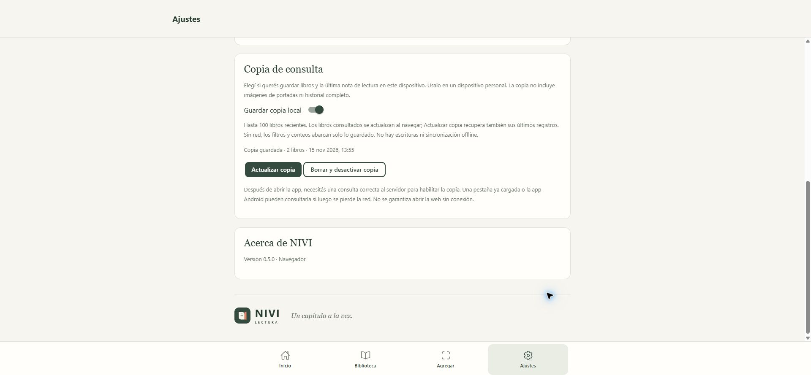

# PR 5: copia local, apariencia y entrega

Fecha: 15 de noviembre de 2026. Cliente **0.5.0**. Implementación local por pedido de la autora; sin Git, ramas, commits, PR remoto ni publicación. PR 5 no modifica ni despliega backend. Azure ya estaba funcionando.

## Resultado revisable

- Apariencia sistema/claro/oscuro persistida, con manejo de almacenamiento bloqueado.
- Copia voluntaria en IndexedDB, esquema 1, por URL de API y máximo 100 libros. Metadatos consultados y últimos registros conocidos; actualización explícita de hasta dos páginas de 50 y detalles en lotes de cuatro.
- Fallback solo ante fallo de transporte tras consulta correcta en ese arranque. Fechas/cobertura y conteos parciales informados; catálogo e historial completo requieren conexión.
- Escrituras bloqueadas desde controles y servicio. Confirmaciones del servidor mantienen o invalidan la entrada; DELETE elimina, versión antigua no reemplaza nueva, 401/403 limpia y revoca, 404 quita el libro.
- Borrado/desactivación espera tareas pendientes y evita reconstruir datos. Marca persistente de actualización incompleta y validación de esquema/fechas; cuota/corrupción se informa sin romper la consulta en línea.
- Icono adaptativo y tema splash reproducibles desde `frontend/nativo/android/res/`, aplicados por el script después de sincronizar Capacitor.
- README, guía Android/Azure, arquitectura vigente, decisión de copia, auditoría, pruebas manuales, guion y autoría actualizados.

No se añade login para cumplir el plan antiguo. La app conserva uso directo y reemplaza «cerrar sesión» por borrado explícito de copia en Ajustes. [Decisión de copia](../decisiones/copia-local.md).

## Verificaciones ejecutadas

| Comprobación | Evidencia |
| --- | --- |
| Maven verify, Java 21 | 64 pruebas, 0 fallos/errores/omisiones, BUILD SUCCESS |
| Angular/Vitest | 104 pruebas, 15 archivos, aprobadas |
| ESLint | Aprobado, cero advertencias |
| Scripts Android | 4 pruebas aprobadas, incluyendo recursos e idempotencia |
| Build web production | Aprobado, aproximadamente 585 kB iniciales sin comprimir |
| Instalación desde fuentes separadas | npm ci con el mismo lockfile: 658 paquetes instalados; primer intento offline no tenía html5-qrcode en caché |
| Auditoría producción | 0 vulnerabilidades reportadas |
| Auditoría completa | 25 moderadas en herramientas; 0 altas/críticas, [impacto y seguimiento](../seguridad-dependencias.md) |
| Android local 0.5.0 | APK debug con HTTPS Azure y recursos propios; Gradle BUILD SUCCESSFUL |
| Android independiente | Regeneración y compilación en .cache/pr5-limpio/frontend: 156 tareas ejecutadas, BUILD SUCCESSFUL |

Las comprobaciones independientes usan `.cache/pr5-limpio/frontend`, con fuentes copiadas sin Android generado, www ni node_modules iniciales. No fue un clonado Git porque el usuario lo prohibió. Se instalaron dependencias desde lockfile, se ejecutaron lint, pruebas, scripts y build. Android se creó con Capacitor y se aplicaron únicamente los scripts/recursos fuente. Ningún ajuste manual del proyecto Android forma parte de la entrega.

Los logs de trabajo quedan en `.cache/pr5-*` y los resultados resumidos en este documento; no se publican logs completos ni datos personales. La preparación inicial de la carpeta de comprobación excluyó por nombre también `nativo/android`; se corrigió la copia de fuentes antes de la compilación final. Esto fue un error de preparación del directorio de prueba, no un paso requerido por los scripts de instalación.

## Recorrido observado en Chrome

Se abrió el frontend local con proxy HTTPS al backend real. Ajustes mostró versión 0.5.0 y los controles nuevos. Se cambió de sistema oscuro a claro y se recargó: la elección persistió. Se activó la copia, se ejecutó Actualizar copia y se observó «Copia guardada · 2 libros» y «Copia actualizada». Tras recargar seguía la copia, comprobando IndexedDB real en navegador.

La prueba activó la copia en ese navegador; puede borrarse/desactivarse desde Ajustes. No se crearon, editaron ni eliminaron libros en Azure. No se desconectó Azure ni se cambiaron sus restricciones. La captura no expone notas ni títulos personales.

## Casos automatizados específicos

Consentimiento; máximo 100 y filtrado/paginación de la cobertura; datos persistidos sin desbloqueo en frío; limpieza ante 401/403; no ocultar 404/409/429/500; corrupción/cuota; invalidación de último registro por versión; eliminación; borrado con tareas en curso; marca de actualización interrumpida; respuesta demorada; fallback HTTP y bloqueo de PUT sin enviarlo; no fabricar historial; historial en línea que no habilita escrituras sobre un detalle de copia; actualización en páginas de 50; biblioteca modificada durante preparación; preferencias y fallo al persistir; retirada de datos de la vista ante 401/403. Las pruebas previas de catálogo, formularios, lectura y escáner permanecen aprobadas.

## Límites de aceptación

No se certifica desconexión real del navegador ni modo avión en teléfono en esta etapa. No se instaló el APK 0.5.0 ni se observó su launcher/splash en dispositivo. La aceptación física de cámara del PR 4 sigue siendo evidencia histórica válida, sin sustituir la regresión de 0.5.0. [Recorrido pendiente](../pruebas-manuales.md).

No se realizó validación visual completa de zoom, pantalla pequeña y teclado, instalación por segunda persona, ensayo, publicación de APK ni CI remota. Azure aún tiene pendiente escritura/idempotencia/persistencia tras reinicio, según su guía; las pruebas locales no certifican esos aspectos del despliegue.

Autora confirmada: **Rocío Antonella Ramaccioni — Ingeniería en Sistemas**. Comisión no informada. El [plan original](../../PLAN_IMPLEMENTACION_NIVI_LECTURA.md) es una propuesta histórica; los criterios que exigen sesión o Git se reemplazan por las decisiones y el alcance autorizados en esta etapa.

## Artefacto local de 0.5.0 (reemplazado por 0.5.1)

APK principal: `frontend/android/app/build/outputs/apk/debug/app-debug.apk`, **35 959 630 bytes**, versión 0.5.0. SHA-256: `ba3ff6f4f29eb5c08497bd307bc69adfde2f3d8d800744c4db52a47497b2ce4d`.

Se inspeccionó el ZIP del APK: `assets/public/configuracion.json` apunta a HTTPS de Azure terminado en `/api/v1`; están incluidos `nivi_marca.xml`, `nivi_launcher.xml` y la política de red. El APK de comprobación independiente también incluye esa configuración y recursos; no se promete igualdad binaria entre carpetas/builds debug.

## Revisión posterior de la autora

La versión actual es 0.5.1: [correcciones de progreso, felicitación, paleta e icono](CORRECCIONES_051.md). Reemplaza el APK del mismo directorio de salida; tamaño y SHA-256 indicados arriba corresponden exclusivamente al artefacto histórico 0.5.0. La evidencia anterior de copia local y regeneración conserva su versión y alcance.
